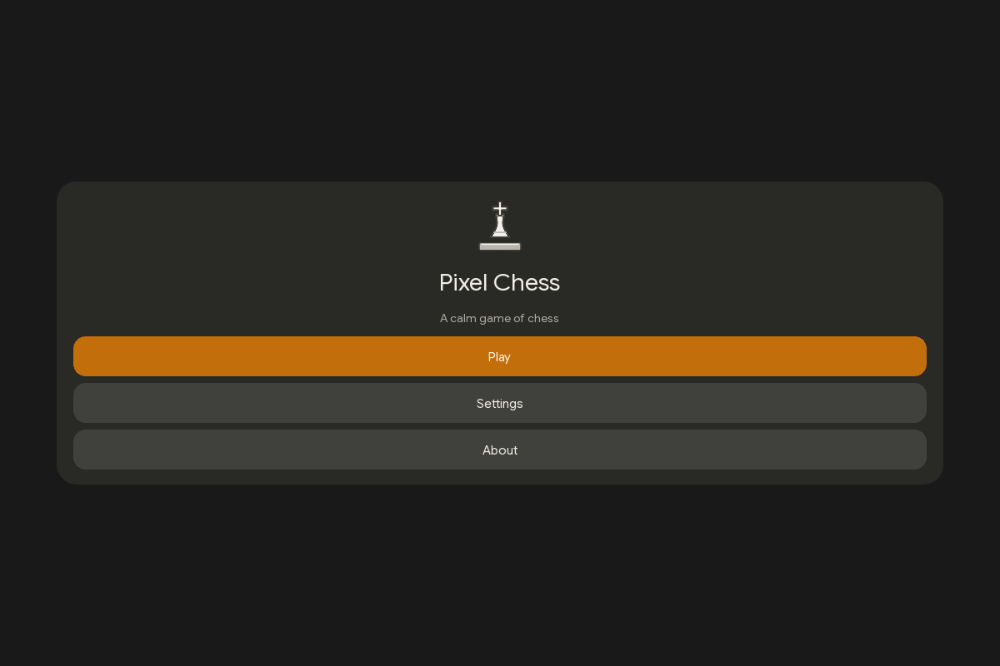
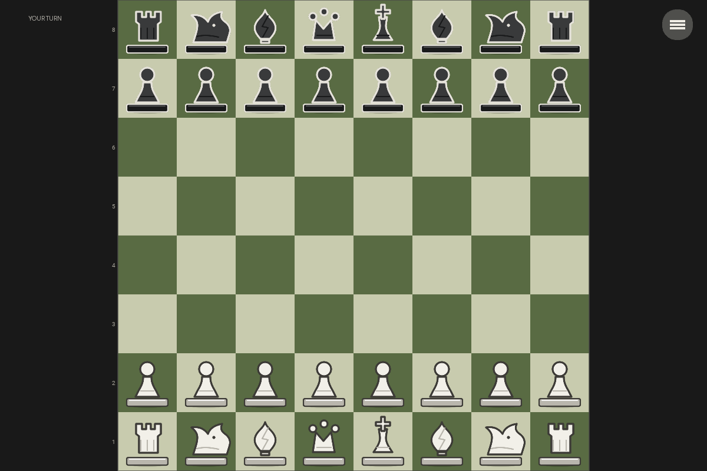
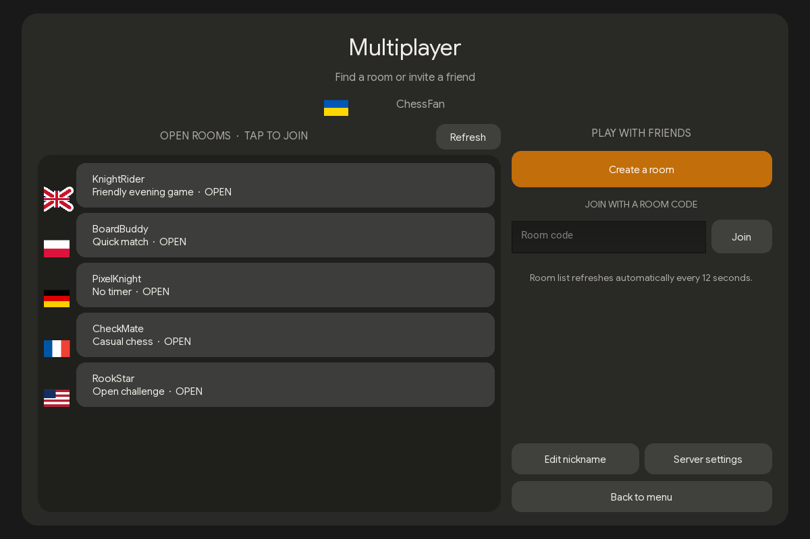

# ♟ Pixel Chess

<p align="center">
  <strong>A calm, polished chess game for Android and desktop.</strong><br>
  Play against a configurable local opponent or meet a friend online.
</p>

<p align="center">
  <a href="https://github.com/mardner4ik/Pixel-Chess/releases/latest"></a>
  <a href="https://github.com/mardner4ik/Pixel-Chess/actions/workflows/release.yml"></a>
  <a href="LICENSE"></a>
  
</p>

<p align="center">
  <a href="https://github.com/mardner4ik/Pixel-Chess/releases/latest">Download the latest version</a>
  · <a href="#screenshots">See screenshots</a>
  · <a href="#multiplayer">Multiplayer setup</a>
</p>

## Screenshots

<p align="center">
  
  
  
</p>

<p align="center"><sub>The multiplayer lobby image uses example room entries to show the layout.</sub></p>

## What you can do

- Play chess locally against an opponent with Easy, Normal, and Hard strengths.
- Choose a side, turn on a 3, 5, or 10 minute clock, or adjust the bot's thinking time.
- See legal moves, drag pieces, and enjoy animated moves with optional move sounds.
- Pick from four board palettes, two piece styles, light and dark themes, and accent colors.
- Listen to five selectable soundtracks, with a separate master volume control.
- Save and resume a singleplayer game, undo a move, or resign.
- Create or join multiplayer rooms, invite by code, and see each player's flag and device.
- Follow a live ghost cursor on desktop and a ghost piece drag on mobile.
- Use the same responsive interface on Android and desktop.

Multiplayer games intentionally do not have Save or Undo. Room creation and moves are relayed by the configured Flask service; see [Multiplayer](#multiplayer).

## Download

Open [GitHub Releases](https://github.com/mardner4ik/Pixel-Chess/releases/latest) and choose the build for your device:

| Platform | Release file | Install / launch |
| --- | --- | --- |
| Android | `pixelchess-*-arm64-v8a-debug.apk` | Download the APK and install it on an ARM64 Android device. |
| Linux x86_64 | `PixelChess-*-linux-x86_64.tar.gz` | Extract it and run `./PixelChess/PixelChess`, or use `./install.sh` to add it to your applications menu. |
| Windows | `PixelChess-*-Setup.exe` | The first Windows installer is planned for v1.2.2. Run it and launch Pixel Chess from the Start menu. |
| Multiplayer server | `pixelchess-multiplayer-server-*.zip` | Upload its files to PythonAnywhere, keep the existing SQLite database, and reload the web app. |

The Linux bundle needs a 64-bit glibc system and system OpenGL/input libraries. On Arch or Artix, install Mesa and `mtdev` if they are not already present. Tagged Windows releases use a Windows runner; the same installer can be assembled locally with Wine as described below.

## Run from source

Requires Python 3.11 or newer. From the project directory:

```bash
python -m venv .venv
source .venv/bin/activate       # Windows PowerShell: .venv\Scripts\Activate.ps1
python -m pip install -r requirements.txt
python main.py
```

From the main menu select **Play → Singleplayer**, then choose the bot strength and your side. In a game, tap a piece to see its legal destinations or drag it to a square. The in-game menu has settings, save, undo, and resign controls. The clock is optional and off by default.

## Multiplayer

The app connects to a separate Flask relay over HTTPS. The service keeps room state and validates moves. During a game clients use short HTTP polling and throttled presence updates to show the opponent's cursor or dragged piece; it is not direct peer-to-peer networking.

1. Deploy the standalone `multiplayer_server/` service to PythonAnywhere (that directory is intentionally excluded from this app repository).
2. Set up its persistent SQLite storage and HTTPS endpoint.
3. In Pixel Chess, open **Multiplayer → Server settings**, enter the service URL, and connect.
4. Choose a nickname. The app detects the displayed country from the player's public IP and the room lobby lists open public rooms.

Create a public room for the lobby or a private room for code-only invites. The host starts the game after the guest joins. Active games show a smoothly interpolated opponent ghost: the pointer on desktop, and only a dragged piece on phones. Room cards and the in-game identity also show country and device icons. Upload the updated standalone server project and reload it to enable these fields and presence updates. Its code and deployment instructions live in the gitignored `multiplayer_server/` directory.

### Test on a local network

Run Flask on the computer with `python app.py`, and keep the computer and phone on the same Wi-Fi network. In the app, connect to `http://<computer-lan-ip>:5000` (for example, `http://192.168.0.104:5000`). Do not use `https://` for the local Flask development server: it serves plain HTTP. Use the HTTPS URL only after deploying behind PythonAnywhere's HTTPS endpoint. If the phone cannot connect, allow inbound TCP port 5000 through the computer's firewall.

## Build

### Android APK

Install [Buildozer's Android prerequisites](https://buildozer.readthedocs.io/en/latest/installation.html), then run:

```bash
buildozer android debug
```

The app configuration is in [`buildozer.spec`](buildozer.spec). Android build output is written to `bin/`.

### Linux desktop bundle

```bash
python -m pip install -r requirements.txt pyinstaller
./packaging/linux/build.sh
```

The generated archive is written to `Release/`. GitHub releases publish the locally built Android APK together with Linux and Windows desktop packages; the desktop packages are built by [the release workflow](.github/workflows/release.yml).

### Windows installer on Linux with Wine

Install Wine, 64-bit Windows Python 3.11, and Inno Setup 6 inside the same Wine prefix, then run:

```bash
./packaging/windows/build-with-wine.sh
```

Set `WINEPREFIX` if the tools are installed in a non-default prefix. The installer is written to `Release/`.

## Project structure

```text
main.py                         Kivy application entry point
chess_app/core/                 Chess rules and local opponent search
chess_app/ui/                   Screens, board, theme, audio, and controls
assets/                         Fonts, piece art, icons, and audio
packaging/linux/                Linux bundle and per-user installer scripts
packaging/windows/              Inno Setup installer definition
docs/screenshots/               README screenshots
```

## Credits and license

Pixel Chess is licensed under [GPL-3.0-only](LICENSE). The UI uses [Kivy](https://kivy.org/), and chess rules are provided by [python-chess](https://python-chess.readthedocs.io/). Google Sans Flex is distributed under the SIL Open Font License; see [`assets/fonts/OFL.txt`](assets/fonts/OFL.txt).

All five selectable soundtracks are by Kevin MacLeod and licensed under [CC BY 4.0](https://creativecommons.org/licenses/by/4.0/): [Friday Morning](https://incompetech.com/music/royalty-free/index.html?Search=Search&isrc=USUAN1100224), [Easy Lemon](https://incompetech.com/music/royalty-free/index.html?Search=Search&isrc=USUAN1200076), [Immersed](https://incompetech.com/music/royalty-free/index.html?Search=Search&isrc=USUAN1600010), [Morning](https://incompetech.com/music/royalty-free/index.html?Search=Search&isrc=USUAN2300003), and [Evening](https://incompetech.com/music/royalty-free/index.html?Search=Search&isrc=USUAN2300002). The app also uses GitHub's mark in its About screen.
